在高并发场景中，数据库既要保证事务之间的隔离性，又要尽可能减少读写操作之间的阻塞。MySQL InnoDB 如何做到在一个事务修改数据时，另一个事务仍然能够正常读取？为什么同样的 SELECT 语句，在读已提交（RC）和可重复读（RR）隔离级别下会得到不同的结果？

这背后的关键机制就是 MVCC（多版本并发控制）。本文从事务并发问题出发，介绍隔离级别与 MVCC 的核心组件，并通过两个事务的完整执行过程，分析 Read View 和 Undo Log 如何协同实现 RC 与 RR。

## 1. 为什么需要事务隔离？

多个事务同时操作数据库时，如果没有适当的并发控制，就可能出现脏读、不可重复读、幻读等问题。

### 1.1 脏读（Dirty Read）

**一个事务读取到了另一个事务尚未提交的数据。**

假设用户余额原本为 1000。

| 时间 | 事务 A        | 事务 B                |
| ---- | ------------- | --------------------- |
| T1   | BEGIN         | BEGIN                 |
| T2   |               | UPDATE balance = 2000 |
| T3   | SELECT → 2000 | 尚未提交              |
| T4   |               | ROLLBACK              |

事务 B 回滚后，余额恢复为 1000。事务 A 却已经读到了一个最终没有生效的值 2000，这就是脏读。

### 1.2 不可重复读（Non-repeatable Read）

**同一个事务中，两次读取同一条记录，由于其他事务提交了修改，导致读取结果不同。**

| 时间 | 事务 A          | 事务 B          |
| ---- | --------------- | --------------- |
| T1   | BEGIN           |                 |
| T2   | SELECT age → 20 |                 |
| T3   |                 | BEGIN           |
| T4   |                 | UPDATE age = 25 |
| T5   |                 | COMMIT          |
| T6   | SELECT age → 25 |                 |

事务 A 两次读取同一个用户，年龄从 20 变成了 25，这就是不可重复读。

### 1.3 幻读（Phantom Read）

**同一个事务中，两次执行相同的范围查询，由于其他事务提交了插入、删除等操作，使得满足查询条件的记录集合发生变化。**

假设 `age >= 18` 的用户原本有 2 人。

| 时间 | 事务 A                                     | 事务 B                          |
| ---- | ------------------------------------------ | ------------------------------- |
| T1   | BEGIN                                      |                                 |
| T2   | SELECT \* FROM user WHERE age >= 18 → 2 行 |                                 |
| T3   |                                            | BEGIN                           |
| T4   |                                            | INSERT INTO user VALUES (3, 22) |
| T5   |                                            | COMMIT                          |
| T6   | 相同范围查询 → 3 行                        |                                 |

事务 A 第二次查询时多出了一条满足条件的记录，就像出现了幻影。

### 1.4 三种问题的区别

| 并发问题   | 核心关注点                         |
| ---------- | ---------------------------------- |
| 脏读       | 读到了未提交的数据                 |
| 不可重复读 | 同一条记录的内容发生变化           |
| 幻读       | 满足相同查询条件的记录集合发生变化 |

不可重复读通常以 UPDATE 为例，幻读通常以 INSERT 为例，但不能仅凭 SQL 类型判断：UPDATE 也可能使记录进入或离开查询范围。

## 2. 事务的四种隔离级别

SQL 标准定义了四种事务隔离级别：

| 隔离级别                     | 英文简称     | 脏读 | 不可重复读 | 幻读     |
| ---------------------------- | ------------ | ---- | ---------- | -------- |
| 读未提交（Read Uncommitted） | RU           | 可能 | 可能       | 可能     |
| 读已提交（Read Committed）   | RC           | 避免 | 可能       | 可能     |
| 可重复读（Repeatable Read）  | RR           | 避免 | 避免       | 标准允许 |
| 串行化（Serializable）       | SERIALIZABLE | 避免 | 避免       | 避免     |

上表是 SQL 标准规定的最低隔离保证，不代表所有数据库的实际实现完全相同。

- **RU**：允许读取其他事务未提交的修改。
- **RC**：普通一致性读只能看到快照建立前其他事务已提交的版本，以及自己的修改。
- **RR**：同一事务的普通快照读通常共享一个一致性快照，也能看到自己的修改。
- **Serializable**：提供等价于某种串行执行顺序的隔离效果，不意味着所有事务必须物理上逐个执行。

MySQL InnoDB 默认隔离级别为 RR。InnoDB 的 RR 比 SQL 标准最低要求更强：普通快照读通过 MVCC 避免幻读；适当的范围加锁读通过 Next-Key Lock 等机制阻止新的匹配记录插入。

查看和设置会话隔离级别：

```sql
SELECT @@transaction_isolation;
SET SESSION TRANSACTION ISOLATION LEVEL READ COMMITTED;
-- 或者（在开启新事务之前执行）
SET SESSION TRANSACTION ISOLATION LEVEL REPEATABLE READ;
```

## 3. MVCC 是什么？

MVCC（Multi-Version Concurrency Control，多版本并发控制）通过维护数据的多个逻辑版本，让事务读取符合自身可见性规则的版本，从而减少读写之间的锁竞争。

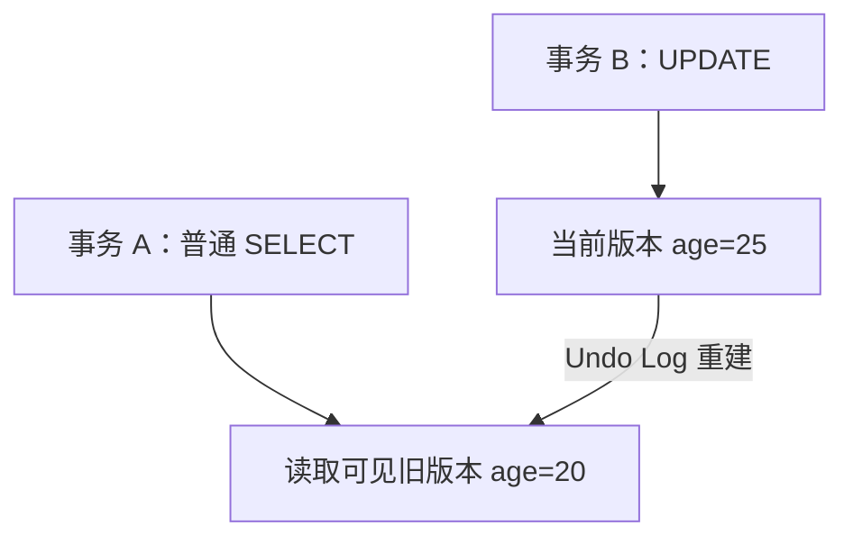

普通快照读通常不需要等待写事务释放行锁。但 MVCC 不代表完全无锁，写写冲突仍需要锁机制处理。

### 3.1 三大核心组件

| 组件      | 属于谁               | 作用                     |
| --------- | -------------------- | ------------------------ |
| 隐藏字段  | 数据行的聚簇索引记录 | 记录修改者、连接历史版本 |
| Undo Log  | InnoDB 回滚日志      | 事务回滚、重建历史版本   |
| Read View | 事务的一致性读上下文 | 判断版本是否可见         |

### 3.2 隐藏字段

假设存在一条记录 `id=1, age=20`，由事务 100 插入。

| id  | age | DB_TRX_ID | DB_ROLL_PTR |
| --- | --- | --------- | ----------- |
| 1   | 20  | 100       | 回滚指针    |

后两个字段是 InnoDB 自动维护的内部字段，普通 `SELECT *` 无法直接查询。

| 字段        | 大小   | 含义                                          |
| ----------- | ------ | --------------------------------------------- |
| DB_TRX_ID   | 6 字节 | 最近插入或修改该记录的事务 ID                 |
| DB_ROLL_PTR | 7 字节 | 指向对应 Undo Log 记录的回滚指针              |
| DB_ROW_ID   | 6 字节 | 没有主键或合适的非空唯一索引时生成的隐藏行 ID |

MVCC 主要依靠前两个字段。隐藏字段是每条聚簇索引记录自己的，不是整张表共用一份。

### 3.3 Undo Log 与版本链

假设事务 100 插入 age=20，事务 102 将其改为 25，后续事务 103 又改为 30（前面的写事务已经提交）。

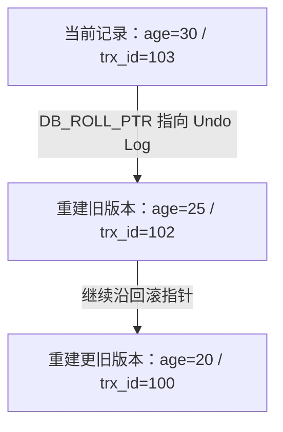

Undo Log 保存的是恢复旧版本所需的信息，并不意味着每次更新都完整复制一行。图中展示的是逻辑版本链。

### 3.4 Read View 是什么？

Read View（读视图）是用于判断数据版本可见性的数据结构。它记录建立视图那一刻的事务状态，而不是业务数据的完整备份。

Read View 的四个核心属性如下（采用常见的概念命名）：

| 属性           | 含义                                                                  |
| -------------- | --------------------------------------------------------------------- |
| m_ids          | 创建视图时已获得事务 ID、尚未结束的读写事务 ID 集合（创建者单独处理） |
| min_trx_id     | 集合中的最小事务 ID；为空时取下一事务 ID 边界                         |
| max_trx_id     | 创建视图时下一事务 ID 的分配边界，并非集合中的最大值                  |
| creator_trx_id | 创建视图的事务 ID（纯读事务可能尚未分配读写事务 ID）                  |

例如事务 101 创建视图时，事务 102 尚未提交，且下一事务 ID 边界为 103：

```text
m_ids          = [102]
min_trx_id     = 102
max_trx_id     = 103
creator_trx_id = 101
```

这里的 `m_ids` 是创建时的快照，不是实时更新的活跃事务列表。本文使用上述概念命名，InnoDB 源码中对应边界常称为 `m_up_limit_id`（较小边界）与 `m_low_limit_id`（较大边界）。

### 3.5 Read View 可见性判断规则

将待判断的数据版本的 `DB_TRX_ID`（记作 `trx_id`）与 Read View 比较，按顺序执行：

| 条件                       | 结果   | 原因                           |
| -------------------------- | ------ | ------------------------------ |
| `trx_id == creator_trx_id` | 可见   | 自己修改的数据                 |
| `trx_id < min_trx_id`      | 可见   | 较早且已结束的事务留下的版本   |
| `trx_id >= max_trx_id`     | 不可见 | 建立视图时尚未分配该事务 ID    |
| `trx_id` 在 `m_ids` 中     | 不可见 | 建立视图时事务仍活跃           |
| 其他情况                   | 可见   | 在边界之间且不活跃，版本已提交 |

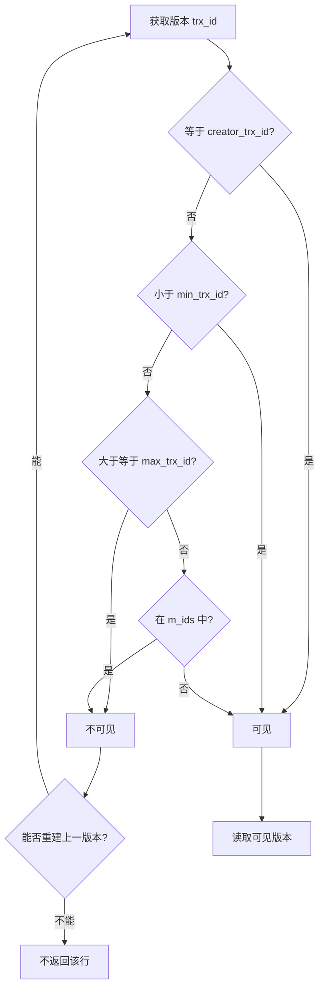

找到可见版本后，还需根据该版本的删除标记和 SQL 查询条件决定是否返回该行。

### 3.6 快照读与当前读

| 对比     | 快照读             | 当前读                                              |
| -------- | ------------------ | --------------------------------------------------- |
| 示例     | 普通 SELECT        | SELECT FOR UPDATE / FOR SHARE、常规 UPDATE / DELETE |
| 数据版本 | Read View 可见版本 | 当前可用版本                                        |
| 行锁     | 通常不加           | 加锁，必要时等待                                    |
| 核心机制 | MVCC               | 锁机制                                              |

在 RC、RR 下，普通 SELECT 通常属于快照读。当前读不使用此前的一致性快照来决定目标行版本；它可能等待其他写事务提交或回滚。某些复杂 DML 存在额外读取行为，此处只讨论常规单表操作。

### 3.7 Read View 什么时候创建？

- RC：每次普通一致性读语句建立新的快照。
- RR：通常第一次普通一致性读建立快照，后续复用直至事务结束。
- 普通 `BEGIN` 并不立即创建 Read View。
- RR 下 `START TRANSACTION WITH CONSISTENT SNAPSHOT` 可以立即建立一致性快照。

## 4. RC 与 RR 的并发场景设计

### 4.1 初始化数据与事务

在两个数据库连接（会话 A 和会话 B）中执行后面的 SQL。每次实验前先结束旧事务并重置数据。

```sql
CREATE TABLE user (
    id INT PRIMARY KEY,
    age INT
) ENGINE=InnoDB;

INSERT INTO user VALUES (1, 20);
COMMIT;
```

初始版本假设由事务 100 插入并提交。为了演示 Read View 的四个字段，假设 A、B 已通过对其他记录的写操作获得 ID 101、102，且下一事务 ID 边界为 103，没有其他活跃读写事务。实际运行纯 SELECT 的 A 可能没有读写事务 ID，实际 ID 也由 InnoDB 分配；不影响实验的查询结果。

两次实验分别使用 RC 和 RR，执行顺序完全一致。

| 时间 | 事务 A（101，负责查询） | 事务 B（102，负责修改） |
| ---- | ----------------------- | ----------------------- |
| T1   | BEGIN                   | BEGIN                   |
| T2   |                         | UPDATE age = 25，不提交 |
| T3   | 第一次 SELECT           |                         |
| T4   |                         | COMMIT                  |
| T5   | 第二次 SELECT           |                         |
| T6   | COMMIT                  |                         |

## 5. RC：读已提交的实现过程

在两个会话开启事务前设置 RC：

```sql
SET SESSION TRANSACTION ISOLATION LEVEL READ COMMITTED;
```

### 第一步：开启事务

A、B 分别执行 `BEGIN;`。A 尚未执行快照读，因此尚未建立 Read View。

### 第二步：B 修改数据，不提交

会话 B：

```sql
UPDATE user SET age = 25 WHERE id = 1;
```

InnoDB 保存恢复旧版本所需的 Undo Log，并更新当前行的 age、DB_TRX_ID、DB_ROLL_PTR。

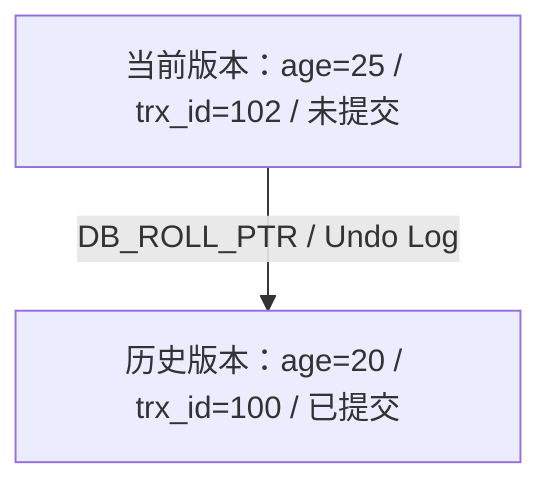

### 第三步：A 第一次 SELECT

会话 A：

```sql
SELECT age FROM user WHERE id = 1;
```

创建 Read View ①：

| 属性           | 值    |
| -------------- | ----- |
| m_ids          | [102] |
| min_trx_id     | 102   |
| max_trx_id     | 103   |
| creator_trx_id | 101   |

判断当前版本 102：不等于创建者，不小于 102，也没有达到 103，但在 `m_ids` 中，因此不可见。

沿 Undo Log 找到旧版本 100：`100 < 102`，可见。

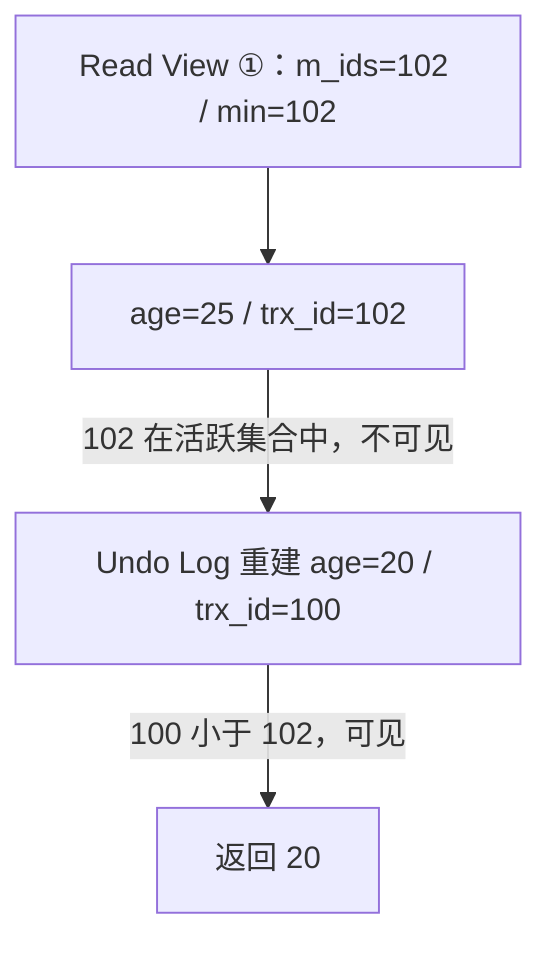

**第一次 SELECT 返回 20，避免脏读。**

### 第四步：B 提交

会话 B：

```sql
COMMIT;
```

事务 102 从系统活跃事务集合中移除，但当前记录的 `DB_TRX_ID` 仍然是 102。提交并不会清除这个隐藏字段。

RC 的第一次查询已经结束，其旧 Read View 不再用于下次查询。若没有其他快照需要旧版本，旧 Undo Log 可能被 Purge 清理。

### 第五步：A 第二次 SELECT

会话 A：

```sql
SELECT age FROM user WHERE id = 1;
```

RC 创建 Read View ②：

| 属性           | 旧 Read View ① | 新 Read View ② |
| -------------- | -------------- | -------------- |
| m_ids          | [102]          | []             |
| min_trx_id     | 102            | 103            |
| max_trx_id     | 103            | 103            |
| creator_trx_id | 101            | 101            |

当前版本 `trx_id=102`，满足 `102 < 103`，直接可见，不必查找 Undo Log。

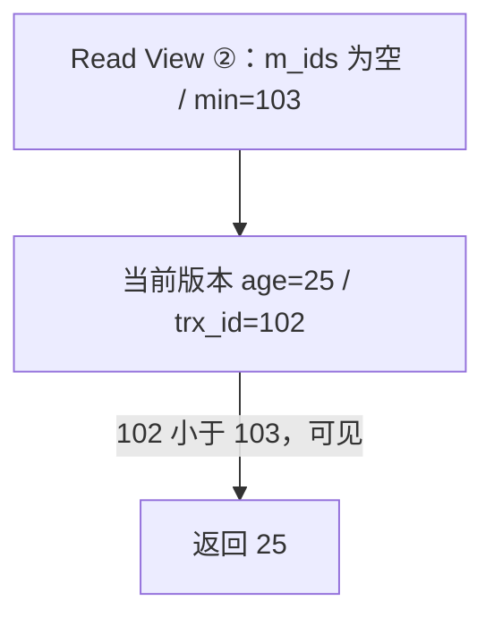

**第二次 SELECT 返回 25。**

### RC 实验结论

同一个事务两次查询得到 20 → 25。RC 每次建立新快照，所以能看到其他事务在两次查询之间提交的修改，避免脏读，但可能出现不可重复读。

最后 A 执行 `COMMIT;`。

## 6. RR：可重复读的实现过程

重新将 age 重置为 20 并提交。为了方便对照，逻辑事务 ID 仍使用 100、101、102；实际数据库会分配新的 ID。

两个会话在开启事务之前设置 RR：

```sql
SET SESSION TRANSACTION ISOLATION LEVEL REPEATABLE READ;
```

### 第一步：开启事务

A、B 分别执行 `BEGIN;`，A 尚未建立 Read View。

### 第二步：B 修改数据，不提交

会话 B：

```sql
UPDATE user SET age = 25 WHERE id = 1;
```

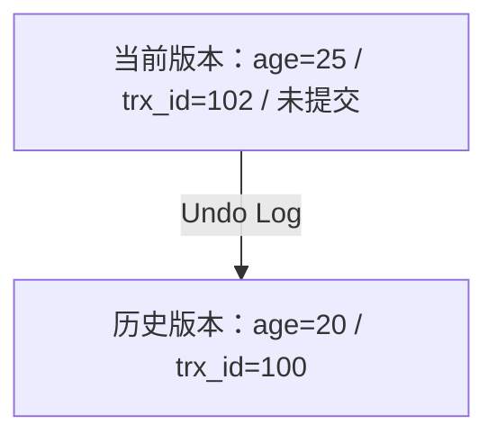

### 第三步：A 第一次 SELECT

会话 A：

```sql
SELECT age FROM user WHERE id = 1;
```

创建 Read View ①：

```text
m_ids          = [102]
min_trx_id     = 102
max_trx_id     = 103
creator_trx_id = 101
```

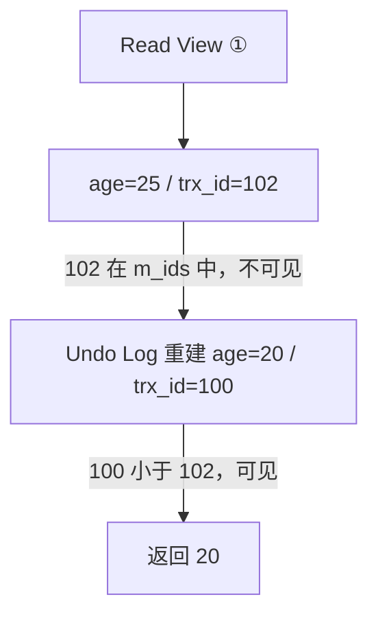

**第一次 SELECT 返回 20。** 到这里为止，RC 和 RR 的行为相同。

### 第四步：B 提交

会话 B：

```sql
COMMIT;
```

| 对象                   | 事务 102 的状态    |
| ---------------------- | ------------------ |
| 系统当前活跃事务集合   | 102 已移除         |
| A 已创建的 Read View ① | m_ids 仍然为 [102] |

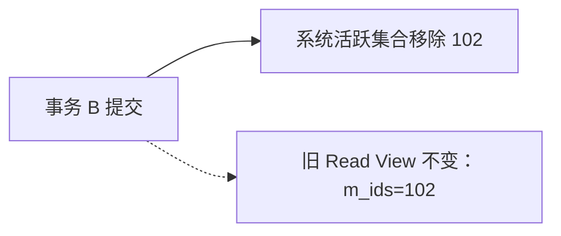

**这是 RR 最关键的一步：B 提交不会刷新 A 的 Read View。** 为保证 A 能继续读旧版本，相关 Undo Log 不能提前清理。

### 第五步：A 第二次 SELECT

会话 A：

```sql
SELECT age FROM user WHERE id = 1;
```

RR 复用原来的 Read View ①，不创建新视图。

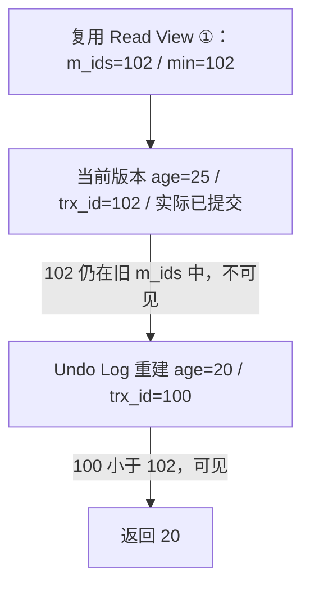

尽管事务 B 实际已经提交，但它在快照建立时尚未提交，所以对 A 的旧快照仍不可见。

**第二次 SELECT 返回 20。**

### RR 实验结论

同一个事务两次查询得到 20 → 20。RR 通过复用 Read View 实现可重复读（假设 A 自己没有修改该记录）。

最后 A 执行 `COMMIT;`，结束原事务。之后开启新事务进行快照读，就可以看到 B 已提交的 25（假设没有其他修改）。

## 7. RC 和 RR 放在一起对比

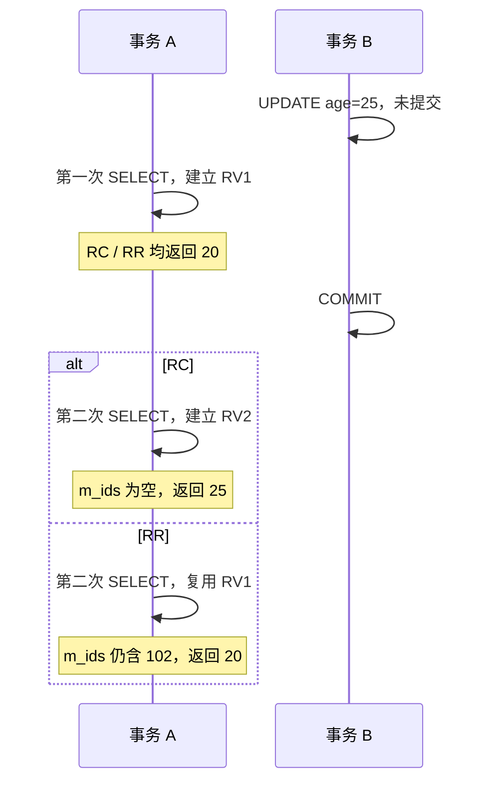

| 对比项                | RC             | RR                   |
| --------------------- | -------------- | -------------------- |
| 第一次 SELECT         | 20             | 20                   |
| B 提交后第二次 SELECT | 25             | 20                   |
| Read View             | 每次快照读新建 | 第一次创建，后续复用 |
| Undo Log 和隐藏字段   | 相同           | 相同                 |
| 可见性判断规则        | 相同           | 相同                 |
| 脏读                  | 避免           | 避免                 |
| 不可重复读            | 可能           | 普通快照读避免       |

## 8. RR 如何处理幻读？

假设 A 在 RR 下第一次查询 `WHERE age >= 18`，返回 2 行。B 随后插入一条 age=22 的记录并提交。

- A 再执行普通 SELECT：复用原快照，新插入版本不可见，因此仍返回原来的 2 行。
- 如果 A 一开始执行适当的范围加锁查询（例如 `SELECT ... FOR UPDATE`），InnoDB 在 RR 下通常通过 Next-Key Lock（记录锁与间隙锁组合）等机制锁住相关索引范围，使 B 的匹配插入可能被阻塞。

两种机制分别服务于快照读和当前读，不能简单认为 MVCC 解决了所有幻读。锁的范围还取决于索引和实际查询方式。

如果 A 先执行普通 SELECT，再执行 `SELECT ... FOR UPDATE`，两种读的可见性不同，后者可能看到 B 已提交的新记录。不能把混合读取方式当成始终使用同一个快照。

## 9. MVCC 的代价与常见误区

- Undo Log 占用存储空间，版本链过长也会增加历史版本重建成本。
- 长事务持有旧 Read View，可能阻止 Purge 清理历史版本。
- MVCC 不能单独解决写写冲突、所有更新丢失等问题，仍需结合锁、原子更新或乐观并发控制。
- RR 下普通 BEGIN 不等于立即建立快照；第一次快照读才是通常的建立时机。
- `DB_TRX_ID` 记录修改者，不是提交时间，也不会因为事务提交而清零。

## 10. 总结

MVCC 是多版本并发控制，InnoDB 通过隐藏字段、Undo Log 和 Read View 维护并读取数据的可见版本。DB_TRX_ID 记录版本修改者，DB_ROLL_PTR 连接 Undo Log，Read View 根据事务 ID 和活跃事务集合判断可见性。如果当前版本不可见，就沿版本链查找历史版本。

RC 和 RR 的核心区别是 Read View 的建立时机：RC 每次快照读创建新视图，RR 通常第一次快照读创建视图并复用。因此 RC 可以读取其他事务后来提交的数据，而 RR 的普通快照读保持一致性。

从实现角度来看，隐藏字段负责标识数据版本并连接历史记录，Undo Log 提供重建历史版本所需的信息，Read View 则定义了版本的可见性边界。三者共同构成 InnoDB 的多版本一致性读机制。RC 与 RR 在这套机制上采用不同的快照生命周期，而写入冲突与范围加锁仍需由锁机制处理。

最后需要明确：**在 RR 隔离级别下，MVCC 通过复用一致性快照，避免同一事务连续快照读中的幻读；但它不能单独解决当前读场景下的幻读。** 普通 `SELECT` 属于快照读，而 `SELECT ... FOR UPDATE`、`SELECT ... FOR SHARE` 以及 `UPDATE`、`DELETE` 等操作属于当前读，需要读取并锁定最新可用版本，不受旧 Read View 的可见性限制。RR 下的范围当前读还需要结合间隙锁、Next-Key Lock 等机制，阻止其他事务向相关索引范围插入记录；具体锁定范围取决于索引和查询条件。RC 每次快照读都会创建新的 Read View，因此不能据此认为 RC 的快照读也能避免幻读。

参考：[MySQL 官方文档：一致性非锁定读](https://dev.mysql.com/doc/refman/8.4/en/innodb-consistent-read.html)、[Next-Key Lock 与幻读防护](https://dev.mysql.com/doc/refman/8.4/en/innodb-next-key-locking.html)。
